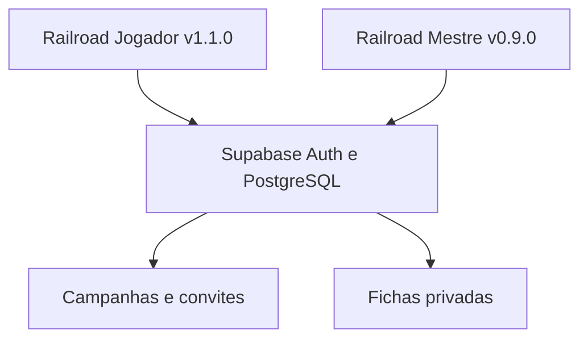
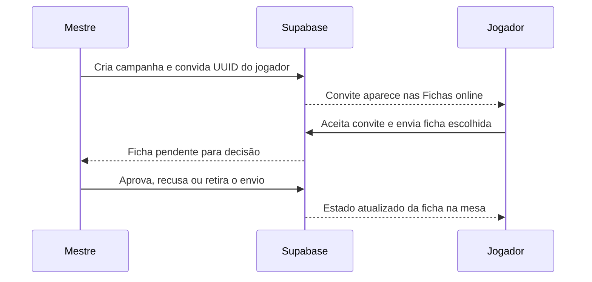

# Arquitetura — Escudo do Mestre v0.9.0

## Dois sites independentes, um Supabase

Os dois sites têm HTML, CSS, JS, repositório e URL próprios. Eles compartilham a URL do projeto Supabase, a chave pública e as identidades do Google. **Não é necessário executar o antigo `003_mestres_leitura.sql`.**

## Fluxo de uma ficha

Uma campanha pode ter vários jogadores. Cada jogador pode enviar **várias fichas online** para a mesma campanha. Cada envio é individualmente aprovado ou recusado. A mesma ficha não pode ser enviada duas vezes simultaneamente à mesma campanha (`unique (campanha_id, ficha_id)`).

## Permissões e dados

| Operação | Jogador proprietário | Mestre da campanha | Terceiros |
| --- | --- | --- | --- |
| Ler dados de Jogador, Personagem e Inventário | Sim | Somente por RPC, com convite aceito e envio pendente/aprovado | Não |
| Editar ou excluir a ficha | Sim | Não | Não |
| Enviar ficha à campanha | Sim, com convite aceito | Não | Não |
| Aprovar ou recusar envio | Não | Sim | Não |
| Retirar ficha da campanha | Sim, a própria | Sim, da sua campanha | Não |
| Criar campanha e convidar jogador | Qualquer conta na função de mestre | Sim, nas próprias campanhas | Não em campanhas alheias |

A migração `004_campanhas_convites.sql` cria três tabelas (`campanhas`, `campanha_convites`, `campanha_fichas`) sem conceder acesso direto via Data API. As operações passam pelas RPCs autenticadas que validam `auth.uid()` no servidor. As tabelas têm RLS ativada.

A RPC `obter_ficha_para_mestre` devolve ao Mestre somente os três blocos autorizados **se**:

1. Ele é o dono da campanha.
2. O convite do proprietário da ficha foi aceito.
3. A ficha foi enviada para a campanha e está pendente ou aprovada.

Uma recusa ou remoção revoga essa via de leitura. O SQL 006 remove a antiga política `fichas_ler_em_campanhas`, que expunha o JSON integral ao Mestre. A política `fichas_ler_proprias` do Jogador permanece. O Mestre não usa `SELECT`, `UPDATE`, `INSERT` ou `DELETE` diretamente em `fichas`: consulta uma projeção autorizada por RPC. As RPCs de aprovação e remoção alteram **somente o vínculo da ficha com a campanha**.

## Métodos utilizados pelo Mestre

| Função pública Supabase | Finalidade |
| --- | --- |
| `criar_campanha_mestre` | Criar campanha da conta autenticada |
| `listar_campanhas_mestre` | Listar próprias campanhas |
| `convidar_jogador_mesa` | Convidar um jogador pelo UUID |
| `listar_convites_mestre` | Consultar convites da campanha |
| `listar_fichas_campanha_mestre` | Consultar envios e decisões |
| `decidir_ficha_campanha` | Aprovar ou recusar envio pendente |
| `remover_ficha_campanha` | Remover vínculo com a campanha |
| `obter_ficha_para_mestre` | Ler apenas Jogador, Personagem e Inventário, sem quadro privado |

O módulo `js/services/campanhas.js` concentra as chamadas. `js/controllers/campanhas.js` e `js/controllers/fichas.js` cuidam das operações e atualizações visuais; `js/modules/visualizarFicha.js` apenas apresenta os dados retornados.

## Navegação e persistência dos novos módulos

A barra superior é controlada por `js/modules/navegacao.js`. Ela exibe uma área de cada vez sem recarregar a página, preservando a sessão autenticada e a campanha selecionada. São sete áreas: Campanhas, Diário, Fichas, NPCs, Combate, Viagem e Utilitários.

A identidade gráfica acompanha o Railroad Jogador: fontes Rye e Smokum, fundo de pergaminho, marrom e dourado. A disposição horizontal das abas vira uma faixa rolável no celular.

O Diário contém sessões numeradas, marcos e notas, e um quadro de ideias. `js/modules/sessoes.js` armazena os dados sob chave separada para cada par **(usuário, campanha)** no `localStorage`, com compatibilidade com rascunhos anteriores. O botão Salvar grava as sessões **localmente**. Essa persistência não depende do SQL 004 e não altera a ficha do jogador.

Os demais módulos são estruturas preparadas para desenvolvimento: Combate lista somente fichas aprovadas e não altera marcadores; Viagem ainda não registra percursos; Utilitários contém referências básicas. Recursos avançados e sincronização online do Diário exigirão futuras alterações específicas de interface e banco.

## Limites de segurança

- A autorização deve existir no banco; esconder botões não impede acesso indevido.
- Uma ficha já vista pode ter sido copiada. Revogar interrompe **consultas futuras**, mas não desfaz capturas anteriores.
- A ficha consultada pelo Mestre é uma projeção JSON com apenas os campos necessários. `desenhoCanvas` e `itensQuadro` nunca são devolvidos pela RPC 006. O proprietário continua tendo acesso à sua ficha completa. Outras políticas de leitura criadas manualmente no banco devem ser auditadas separadamente.
- Qualquer conta Google autenticada pode criar sua própria campanha; ainda não há papeis administrativos globais.
- A interface não implementa exclusão de campanhas; remoções e recusas são deliberadamente restritas a convites e envios.

## Migrações necessárias

1. `001_fichas_privadas.sql` — base existente do Jogador.
2. `002_importacao_sem_duplicatas.sql` — proteção existente contra duplicações.
3. **`004_campanhas_convites.sql`** — campanhas, convites e envios.
4. **`005_escudo_campanhas.sql`** — descrição, participantes e exclusão da mesa.
5. **`006_fichas_leitura_privada.sql`** — leitura parcial e privacidade do quadro de ideias.

**O antigo `003_mestres_leitura.sql` não é dependência desta arquitetura.** O arquivo de campanhas pode ter sido renomeado para 003 no projeto do Jogador sem alterar sua função.

## v0.4.0 — Escudo do Mestre / Campanhas

- `js/modules/participantes.js`: agrupa registros da RPC por jogador, permitindo várias fichas sem repetir o cartão do jogador.
- `js/services/campanhas.js`: mantém o acesso ao Supabase por RPCs, incluindo criação com descrição, listagem de participantes e exclusão de jogador.
- `supabase/005_escudo_campanhas.sql`: migração **aditiva**, aplicada depois do SQL 004; adiciona `campanhas.descricao` e quatro RPCs com autorização no servidor.
- A lista de jogadores é obtida de `auth.users.raw_user_meta_data` (nome público) e das fichas enviadas, **sem expor e-mail**. A RPC verifica se o usuário autenticado é o Mestre proprietário da campanha.
- **Aceitar entrada** e **Negar entrada** operam na aprovação de uma ficha enviada. O convite em si é aceito apenas pelo jogador.
- **Excluir da mesa** remove o convite do jogador; os envios relacionados são removidos pela FK `ON DELETE CASCADE`. A tabela `fichas` e seus dados pessoais permanecem intactos.
- A seleção da campanha é explícita no carregamento inicial; a campanha recém-criada passa a ser selecionada automaticamente.

## v0.5.0 — Diário de sessões e layout compacto

- `js/modules/sessoes.js`: repositório local versionado por usuário/campanha, com migração dos rascunhos v0.4.0. Duplicação e ordenação de sessões sem alterar os dados originais.
- `js/modules/quadroMestre.js`: ferramentas equivalentes às do quadro do Jogador; desenho no canvas, textos/imagens arrastáveis, redimensionamento e upload/colagem de imagens.
- `js/mesa.js`: mantém em memória as alterações de todas as sessões; Salvar persiste a lista inteira no armazenamento local. Trocas de campanha verificam alterações não salvas.
- Layout de altura da janela em desktop. Conteúdos ilimitados usam rolagem interna; em mobile mantém-se a rolagem normal para não ocultar controles.
- **Não há SQL novo**. O diário não altera a tabela `fichas` nem a estrutura de campanhas no Supabase.

## v0.7.0 — Refatoração por responsabilidade

A interface passou a ser composta por **fragmentos HTML locais**:

- `index.html`: estrutura, barra superior, login e pontos de montagem.
- `views/pages/`: um arquivo para cada uma das sete abas.
- `views/dialogs/`: criação e gerenciamento de sessões.
- `js/core/carregarInterface.js`: faz `fetch` de todos os fragmentos, verifica erros HTTP e monta o DOM **antes** de inicializar os controladores.

A lógica foi separada em:

- `js/mesa.js`: bootstrap, autenticação e registro de eventos.
- `js/app/estado.js`: estado da sessão, campanhas, fichas e diário.
- `js/controllers/campanhas.js`: criação, seleção, convites, participantes e atualização do Supabase.
- `js/controllers/diario.js`: edição de sessões, ordenação, gerenciamento, salvamento local e mensagens de alteração pendente.
- `js/controllers/fichas.js`: listagem, aprovação/recusa, remoção e visualização somente leitura.
- `js/core/dom.js`: construção de elementos e ações reutilizáveis.

Os controladores recebem um contexto compartilhado, evitando imports circulares. As funções existentes dos módulos `sessoes.js`, `quadroMestre.js`, `navegacao.js` e dos serviços Supabase foram mantidas.

A folha `css/mesa.css` agora importa arquivos por área (`layout`, `campanhas`, `diario`, `ferramentas`, `fichas`, `npcs`, `sessoes`) e, por último, `responsivo.css`. A distribuição do Diário permanece em 40%/60%, mas o seletor está à esquerda, os botões à direita e o título do quadro na mesma linha das ferramentas.

**Na v0.7.0 não houve migração SQL.** O projeto requer servidor HTTP para carregar os fragmentos; Live Server e GitHub Pages são compatíveis. Publicar `index.html` sem a pasta `views/` causa erro explícito de carregamento.

## v0.8.0 — Fichas em três partes e privacidade do quadro

- `views/pages/fichas.html`: seletor de personagem e três botões de comparação; sem formulário de edição, quadro de ideias ou JSON técnico.
- `js/controllers/fichas.js`: consulta as fichas compartilhadas, preserva a seleção, compara cada parte e ignora resultados atrasados após troca de campanha. Os controles de aprovação/recusa continuam na aba Campanhas.
- `js/modules/visualizarFicha.js`: monta as partes **Jogador**, **Personagem** e **Inventário** usando `textContent`, sem executar HTML fornecido por jogadores.
- `css/fichas.css`: três colunas de largura proporcional no desktop, rolagem vertical por coluna e rolagem horizontal dentro do quadro para múltiplas fichas. A página não rola ao consultar fichas.
- `supabase/006_fichas_leitura_privada.sql`: remove a política anterior de leitura integral do Mestre e oferece a RPC `obter_ficha_para_mestre(campanha_id, ficha_id)` com lista explícita de campos, sem `desenhoCanvas` nem `itensQuadro`. Exige autenticação, propriedade da campanha, convite aceito e envio pendente/aprovado.

A versão antiga do Mestre não consegue mais usar `SELECT` direto após aplicar o SQL 006. Isso é intencional: é preciso publicar a v0.8.0 junto com a migração para preservar a privacidade. Nenhum dado é apagado.

## v0.9.0 — NPCs privados e ajustes na lista de Campanhas

- `views/pages/npcs.html`: sétima aba, lista de NPCs e editor de fichas simplificadas/completas.
- `js/modules/npcs.js`: modelo normalizado dos 12 traços, condições, armas e demais campos. Os valores são limitados e validados.
- `js/modules/formularioNpc.js`: gera os controles repetitivos de traços, condições e armas.
- `js/modules/visualizarNpc.js`: apresenta fichas somente leitura sem interpretar HTML dos campos.
- `js/services/npcsLocal.js`: repositório local privado por par `(usuario_id, campanha_id)`. Não acessa tabelas de jogadores nem o Supabase.
- `js/controllers/npcs.js`: criação, busca, consulta, edição e exclusão, com confirmação de descarte de alterações.
- `css/npcs.css`: painel de consulta com rolagem interna em desktop e organização vertical no celular.
- Em Campanhas, o marcador de status do convite fica abaixo do nome do jogador; **Excluir da mesa** fica à direita abaixo dos personagens.
- A navegação inclui NPCs e pode impedir a saída de uma edição não salva. O botão Salvar global também conclui uma edição de NPC aberta.

**Não há SQL novo.** A persistência dos NPCs é local e privada do navegador, assim como a do Diário. Ela não é uma política de segurança do Supabase e não sincroniza dispositivos. Para armazenar NPCs no servidor futuramente, criar uma tabela com RLS que valide o Mestre proprietário da campanha antes de liberar leitura ou escrita.
